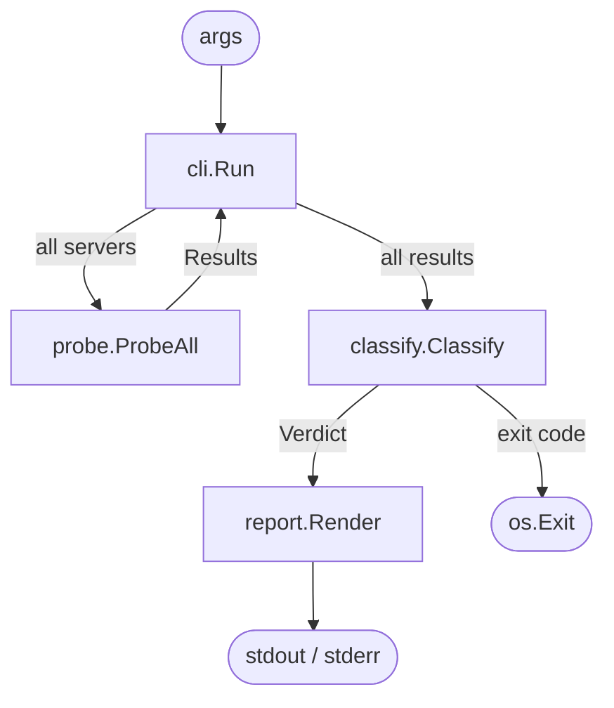

# natcheck — Architecture

> Status: v0.1.6 shipped. v0.2 design contract is the addendum at end of document.
> Last updated: 2026-11-26

Product framing and technical spec. v0.1 spec lives in this document as shipped; v0.2 design is the addendum at the end.

## Problem

Every WebRTC, P2P, or VPN developer hits the same question when connections fail: *"what kind of NAT am I behind, and will my connections work?"* Today, answering that means:

- Running `stun-client` against one or two servers and eyeballing the mapped address
- Finding a dusty online NAT classifier that may or may not still work
- Reading RFC 5780 to understand what "endpoint-independent mapping" means in practice
- Guessing at whether the result means your P2P app will or won't work

The answer exists in scattered pieces. No one tool packages it.

## Audience

Two user personas, both served by the same default invocation:

1. **WebRTC / P2P developer debugging connectivity.** Wants a fast, unambiguous answer: "will direct P2P work from this network, and if not, is TURN required?" Time budget: 5 seconds.
2. **Curious network person.** Wants to understand their home or office NAT in RFC 5780 terms. Time budget: a minute, with willingness to read one paragraph of explanation.

Secondary: CI scripts that want to assert a network's NAT type before running integration tests. Served by `--json` output + well-defined exit codes.

## Value proposition

- **One command, one answer.** `natcheck` with no flags produces a complete report.
- **Human-readable by default, machine-readable on request.** Default output is a screenful; `--json` is pipeable.
- **Honest about limits.** Many public STUN servers don't support RFC 5780 CHANGE-REQUEST, so full classification is sometimes impossible. The tool says so instead of guessing.
- **No setup.** Single binary, no services to run, no config files required.
- **Pion-native.** Built on `pion/stun`, pure Go, single static binary.

## v0.1 scope

In:

- STUN Binding request against 2+ servers (defaults: `stun.l.google.com:19302`, `stun.cloudflare.com:3478`)
- Public endpoint reporting (IP:port as observed by each server)
- Mapping-behavior classification: Endpoint-Independent vs Address/Port-Dependent, based on whether mapped endpoints agree across servers
- RTT measurement per server
- Human-readable default output (one screen)
- `--json` flag for structured output
- `--verbose` flag showing each STUN transaction
- `--server host:port` flag, repeatable, to add or override servers
- `--timeout duration` flag (default 5s)
- `--version`, `--help`
- WebRTC forecast: `likely | possible | unlikely | unknown`. `likely` needs measured endpoint-independent filtering; EIM otherwise reads `possible`
- Warning `cgnat_detected` when an address family's first mapped address is in 100.64.0.0/10 (a server inside a carrier or overlay network)
- Exit codes: 0 (P2P-friendly), 1 (P2P-hostile), 2 (probe error)

Out of scope:

- TURN probing
- IPv6 exhaustive testing (works in practice via `pion/stun` + Go's net package when available, but not a tested contract)
- Multi-interface enumeration
- Continuous monitoring / watch mode
- TUI
- TCP STUN

## Non-goals

- Not a general network diagnostic tool. Scope is NAT and STUN only.
- Not a TURN server or relay. `natcheck` probes; it doesn't serve.
- Not a WebRTC test harness. For end-to-end WebRTC testing, use pion's examples or `webrtc-internals`.

## UX shape

### Default invocation

```
$ natcheck
Direct P2P: possible
NAT type: Endpoint-Independent Mapping (cone)
Public endpoint: 203.0.113.45:51820

Probes:
  stun.l.google.com:19302   rtt=24ms  mapped=203.0.113.45:51820
  stun.cloudflare.com:3478  rtt=31ms  mapped=203.0.113.45:51820

Filtering not tested (v0.1).
```

Forecast leads the output so the WebRTC-dev persona gets the answer on line 1. Classification detail follows for the curious reader.

### JSON invocation

```json
{
  "nat_type": "EIM",
  "nat_type_legacy": "cone",
  "public_endpoint": "203.0.113.45:51820",
  "probes": [
    {"server": "stun.l.google.com:19302", "rtt_ms": 24, "mapped": "203.0.113.45:51820"},
    {"server": "stun.cloudflare.com:3478", "rtt_ms": 31, "mapped": "203.0.113.45:51820"}
  ],
  "webrtc_forecast": {"direct_p2p": "possible", "turn_required": false},
  "warnings": ["filtering_behavior_not_tested"]
}
```

The JSON schema is a public contract from v0.1 onward; only additive changes after release.

### Failure modes

- All probes fail → exit 2, report per-server errors. Forecast `unknown` with `turn_required: false` when a server replied to a request without a usable mapping (such as an error response, or a success with no mapped address); otherwise `turn_required: true`, with `unlikely` when a request left the host and `unknown` when none did (`TestClassify`)
- A mapping probe that gets no reply but, before its deadline, a packet from the server's address that does not decode reads `undecodable reply from <address>`, not `no response`; that packet does not set `Replied` or change the forecast (`TestProbe_GarbledResponse`, `TestProbe_GarbledThenValidReplySucceeds`, `TestProbe_RepliedWithoutMapping`)
- Mapped endpoints disagree across servers → NAT type "Address-Dependent Mapping" with warning `adm_or_stricter`, or ADM or APDM without the warning when RFC 5780 Tests II and III refine it (see Mapping tests; `TestClassify_MappingTest`); exit 1, forecast `unlikely`
- An address family's first mapped address in `100.64.0.0/10` (a server inside a carrier or overlay network) → warning `cgnat_detected`, forecast `unknown`

## Architecture

Single binary, four internal packages. No daemons, no config files by default, no external services beyond the STUN servers being probed.

```
cmd/natcheck/main.go          Entry point, calls cli.Run
internal/cli/                 Flag parsing, orchestration, exit codes
internal/probe/               STUN Binding requests, RTT capture
internal/classify/            Probe results → NAT-type verdict
internal/report/              Verdict → human text or JSON
```

### Data flow

```
args
 │
 ▼
cli.Run ─────────► probe.ProbeAll  (one socket per address family)
 │                    │
 │◄── probe.Result ───┘
 │
 ▼
classify.Classify ─► Verdict ─► report.Render ─► stdout / stderr
                       │
                       └─► exit code (0 / 1 / 2)
```



## Dependencies

- **Runtime:** `github.com/pion/stun/v3` (latest stable). Nothing else for v0.1.
- **Dev:** `golangci-lint` v2.9.0+.
- **Go version:** 1.25+.

Rejected for v0.1:

- `cobra` / `urfave/cli` — `flag` is sufficient for a single-command CLI with < 10 flags.
- `zerolog` / `slog` — `fmt` is sufficient; structured logging arrives if and when the tool gains subcommands.
- `viper` — no config file in v0.1.

## Package contracts

### `internal/probe`

```go
type Server struct {
    Host string
    Port int
}

type Result struct {
    Server       Server
    Target       netip.AddrPort // resolved address, zero if nothing was sent
    Mapped       netip.AddrPort // zero if probe failed
    Other        netip.AddrPort // OTHER-ADDRESS, zero if not advertised
    RTT          time.Duration  // zero if probe failed
    Replied      bool           // a reply with this request's transaction ID arrived from the target, usable or not (TestProbe_RepliedWithoutMapping)
    Untranslated bool           // Mapped is an interface address of this host with the probe's local port (TestProbe_Untranslated)
    Err          error          // nil on success
}

type Prober interface {
    ProbeAll(ctx context.Context, servers []Server) []Result
}
```

One `Prober` implementation: `stunProber` using `pion/stun` primitives (`Build`/`Decode`) over raw UDP. Servers in one address family share one local socket, because mapped endpoints are only comparable from the same local endpoint. Requests go out concurrently and replies are matched by source and transaction ID; anything else is dropped. Unanswered requests are retransmitted at 0.5, 1.5 and 3.5s under the `ctx` deadline. Failures return a `Result` with non-nil `Err`; callers never panic.

### `internal/classify`

```go
type NATType int

const (
    Unknown NATType = iota
    EndpointIndependentMapping  // RFC 5780, "cone"
    AddressDependentMapping     // RFC 5780, "symmetric"; with adm_or_stricter, means "not EIM"
    AddressPortDependentMapping // RFC 5780, "symmetric"; only from Tests II and III
    Blocked                     // all probes failed
)

type Verdict struct {
    Type            NATType
    LegacyName      string    // "cone", "symmetric", etc.
    PublicEndpoint  netip.AddrPort
    CGNAT           bool
    FilteringTested bool      // false in v0.1 always
    Warnings        []string
    Forecast        Forecast
}

type Forecast struct {
    DirectP2P    string // "likely" | "possible" | "unlikely" | "unknown"
    TURNRequired bool
}

func Classify(results []probe.Result) Verdict
```

Pure function. No I/O. Table-driven tests cover RFC 5780 classification boundaries, CGNAT detection, and the partial-failure matrix (0/N, 1/N both orderings, N/N probes successful).

### `internal/report`

```go
type Format int

const (
    FormatHuman Format = iota
    FormatJSON
)

func Render(w io.Writer, v classify.Verdict, probes []probe.Result, format Format) error
```

Human format is hand-rolled string building, forecast-first. JSON format uses `encoding/json` with tagged structs, pinned by golden-file tests (EIM cone, ADM strict, Blocked) since the schema is a public contract.

### `internal/cli`

```go
type Options struct {
    Servers []probe.Server
    Timeout time.Duration
    JSON    bool
    Verbose bool
}

func Run(ctx context.Context, args []string, out, errOut io.Writer) int
```

Returns exit code. Parses flags, defaults servers, runs probes concurrently (one goroutine per server, bounded by timeout), calls `Classify`, calls `Render`. Testable in-process with a fake `Prober`.

## Default STUN servers

v0.1 ships with two defaults, both well-known and free:

1. `stun.l.google.com:19302`
2. `stun.cloudflare.com:3478`

Adding a third would make classification marginally more robust; two plus `--server` override is sufficient. If a default server times out, we still report what we learned from the others and warn.

## RFC 5780 mapping classification

With only basic STUN Binding responses (no `CHANGE-REQUEST`), we can determine:

- **Mapping behavior:**
  - Two servers on different IPs, probed from the same local port, return the *same* mapped endpoint → Endpoint-Independent Mapping
  - Different mapped endpoints → Address-Dependent or Address-Port-Dependent Mapping. Two servers cannot separate them, so natcheck reports ADM with warning `adm_or_stricter` unless Tests II and III refine it (see Mapping tests below; `TestClassify_MappingTest`).

Mappings that agree across fewer than two server IPs read `Unknown` with warning `insufficient_server_diversity`: one IP cannot separate EIM from ADM.

When every successful probe, in every address family, maps to one of this host's interface addresses with the port it left from, the warning `no_nat` reports that nothing on the path translated it. One probe is enough. The type, legacy name and forecast stay those of the mapping (`TestClassify_NoNAT`, `TestProbe_Untranslated`, `TestRun_MappingBehaviorOverRealSockets`).

Filtering needs `CHANGE-REQUEST`, covered below.

## CGNAT detection

When an address family's first mapped address is in `100.64.0.0/10` (RFC 6598 shared address space), the server sits inside a carrier or overlay network, such as a tailnet. The request never crossed the NAT between that network and the internet, which is the one peers see, so natcheck emits warning `cgnat_detected` and forecasts `unknown` (`TestClassify`).

Against public servers this does not fire: a carrier NAT translates the range before the request leaves the carrier. Behind a carrier NAT the probes cross it, so the mapping verdict covers every NAT on the path, the carrier's included (`TestRun_MappingBehaviorOverRealSockets`, the chained NAT cases).

natcheck does not infer a carrier from this host's own address: an address in `100.64.0.0/10` can equally come from Tailscale, another overlay or a pod network.

A server on a private network (RFC 1918, ULA) has the same blind spot and is not flagged (`TestClassify`): test labs put a NAT's outside on private addresses, so a private mapped address alone does not show that the path stopped short.

## Concurrency model

Probes run concurrently under a single context timeout, one socket per address family with one reader per socket. If the timeout fires, unanswered probes are recorded as errors. `Classify` waits for all probes (success or error) before running.

## Testing strategy

- **`internal/probe`:** integration tests against an in-process fake STUN responder (spawned per-test). No network required in CI.
- **`internal/classify`:** table-driven unit tests covering every combination of probe outcomes, including the partial-failure matrix (0/2, 1/2 both orderings, 2/2).
- **`internal/report`:** golden-file tests for human output; schema-stability golden-file tests for JSON with three fixtures (EIM cone, ADM strict, Blocked).
- **`internal/cli`:** in-process test with a fake `Prober` for exit codes and orchestration, plus real-socket mapping tests through a simulated NAT, since a stub cannot observe which local socket a probe left from.
- **`cmd/natcheck`:** no test; entry point is three lines.

No live-network test in CI. Manual verification against real networks before release; sample outputs committed under `docs/samples/`.

## Build and release

- `make build` → single binary in repo root, versioned via `-ldflags "-X main.version=..."`
- `make test` → unit + integration with in-process test server, no network
- `make lint` → `golangci-lint` v2.9.0
- Release: `git tag v0.1.0`, push.

## Non-functional targets

- Cold-start probe completes in < 2s on a healthy network
- Binary size < 15 MB static
- `--json` schema is a public contract; additive changes only after v0.1
- `go install github.com/1mb-dev/natcheck/cmd/natcheck@latest` works with no further setup

## Security considerations

- No private keys, no credentials, no user data sent to STUN servers beyond the standard Binding request.
- `--server` accepts user input; validate `host:port` shape before handing to `pion/stun`.
- Treat STUN responses as untrusted: `pion/stun` handles parsing. No further eval.
- No subprocess execution. No file I/O (no config file in v0.1).

---

# v0.2 design (addendum)

> Added: 2026-04-26
> Status: design contract. Implementation staged across v0.1.x patches to v0.2.0.

## Goal

RFC 5780 parity with `pion/stun-nat-behaviour` on protocol rigor while preserving the v0.1 UX contract: one command, pinned JSON, honest CGNAT handling, layered exit codes.

## Staged sequence

v0.2 is a milestone reached via bisectable patches, not a single release. Each patch is independently shippable with real user value.

| Patch | Status | Adds |
|---|---|---|
| **v0.1.2** | shipped (PRs #7–#11, tag `v0.1.2`) | RFC 5780 §4.4 filtering classification (capability-driven via `--server` advertising `OTHER-ADDRESS`); JSON `filtering` object; classifier upgrade emitting reserved `possible`; coturn reference config asset + setup doc; `internal/stunserver` foundation package |
| **v0.1.2.x** | shipped (tags `v0.1.2.1`, `v0.1.2.2`) | coturn config + setup doc fixes so v0.1.2's filtering classification works on more provider topologies; `scripts/validate-coturn.sh` provisioner. No code or schema delta. (4-segment tags incompatible with Go module versioning — see those releases' notes; lesson recorded.) |
| **v0.1.3** | shipped (tag `v0.1.3`) | Cross-address-family mapping classification fix (#14): per-family grouping + combine. New `mixed_address_family_probes` warning. Hairpinning shifts to v0.1.4. |
| **v0.1.4** | shipped (tag `v0.1.4`) | Hairpinning detection via two local sockets, parallel with mapping probes; JSON `hairpinning` field |
| **v0.1.5** | shipped (tag `v0.1.5`) | Mapping measured from one socket per address family (#28), server-diversity guard, filtering source checks, mapping retransmission. |
| **v0.2.0** | planned | Version bump; README + site copy reconciliation; CHANGELOG with v0.1 → v0.2 JSON migration section |

v0.2.0 is the line where downstream consumers can rely on the new schema fields.

## JSON schema delta (additive only)

```jsonc
{
  // existing v0.1 fields unchanged
  "nat_type": "EIM",
  "nat_type_legacy": "cone",
  "public_endpoint": "203.0.113.45:51820",
  "probes": [...],
  "webrtc_forecast": { "direct_p2p": "likely", "turn_required": false },
  "warnings": [],

  // NEW in v0.1.2
  "filtering": {
    "behavior": "endpoint-independent" | "address-dependent" | "address-and-port-dependent" | "untested",
    "tested_against": "stun.example.com:3478"
  },

  // NEW in v0.1.3
  "hairpinning": true | false | null
}
```

- `filtering.tested_against` is omitted when `behavior == "untested"`.
- `hairpinning: null` distinguishes "tested and false" from "didn't try."
- Schema additivity discipline: once these fields ship, all future filtering / hairpinning fields nest under their respective objects or break the v0.1.2 / v0.1.3 contract.

A v0.1-equivalent golden fixture (filtering=untested, hairpinning=null) is pinned as a regression check on the omitted-field path.

## CLI delta

### Client side: no new flags

Filtering activates automatically when the configured server's Binding response includes `OTHER-ADDRESS`. Hairpinning runs by default — local-only, parallel with mapping probes, no wall-clock cost in the common case.

Verbose output emits coded warning constants in `warnings[]`:

| Constant | Condition |
|---|---|
| `WarnFilteringSkippedNoChangeRequest` | Server didn't advertise `OTHER-ADDRESS` |
| `WarnHairpinUntested` | Hairpinning not measured; see Hairpinning detection |

No free-text warning strings.

## Filtering classification

Implements RFC 5780 §4.4. Sequence:

1. Standard Binding request to a server advertising `OTHER-ADDRESS` (the cooperating server).
2. Binding with `CHANGE-REQUEST = CHANGE-IP | CHANGE-PORT` — server responds from alternate IP and port.
3. Binding with `CHANGE-REQUEST = CHANGE-PORT` — server responds from same IP, alternate port.

Outcome mapping:

| Test 2 reply | Test 3 reply | Filtering |
|---|---|---|
| received | received | endpoint-independent |
| not received | received | address-dependent |
| not received | not received | address-and-port-dependent |

Each test waits half the filtering budget (750ms by default). When that window is longer than 500ms, the request is resent at 500ms with the same transaction ID. For Test 2 or 3, silence for the whole window reads as not received (`TestProbeFiltering_ResendsLostChangeRequests`); a send that fails, or a read that fails for any reason but its deadline, leaves filtering untested (`TestProbeFiltering_LocalFaultIsNotFiltering`).

A Test 2 or Test 3 reply that lacks the change asked for, or an error reply, means the server ignored or rejected `CHANGE-REQUEST`, so neither test measured anything and filtering stays untested. Replies are compared to the target, not `OTHER-ADDRESS`, because provider topologies can reply from an address other than the advertised one.

If the server doesn't advertise `OTHER-ADDRESS`, all filtering tests skip; `WarnFilteringSkippedNoChangeRequest` is emitted; `filtering.behavior = "untested"`.

### Mapping tests (RFC 5780 §4.3)

After Tests 2 and 3, on the same socket, natcheck sends Test II to `OTHER-ADDRESS`'s IP with the target's port and Test III to `OTHER-ADDRESS`. They run last because a request to `OTHER-ADDRESS`'s IP opens an address-dependent filter for Test 2's reply (`TestProbeFiltering_MappingTests`). They also run when the server ignored `CHANGE-REQUEST`, and not after a local fault; Test III is not sent when Test II gets no reply (`TestProbeFiltering_MappingTestsAfterIgnoredChangeRequest`, `TestProbeFiltering_LocalFaultIsNotFiltering`). Each gets the same window as a filtering test, so with Test 1 the sequence waits on at most five windows: 3.75s at the 1.5s filtering budget, stated in `--timeout`'s help (`TestProbeFiltering_MappingTests`, `TestSendBindingAndWait_SilenceEndsAtWindow`, `TestRun_Help`).

These and the hairpin tag are the only packets sent to an address a server chose. Each is skipped unless that address has the family and scope of the server address it came from (loopback, link-local, private, public, or the same block of the IANA IPv4 and IPv6 Special-Purpose Address Registries, such as `100.64.0.0/10`), is not in a block natcheck never sends to (unspecified, limited broadcast, discard-only, IPv6 dummy, SRv6, and the NAT64, Teredo and 6to4 prefixes that embed an IPv4 address), and is in `2000::/3` when it is a public IPv6 address (`TestMappingTestAllowed`, `TestMappingTestAllowed_SpecialRanges`, `TestSpecialRanges_MatchIANARegistry`, `TestHairpinAddrs_MappedOutsideScopeSendsNothing`). Tests II and III also need a port other than the target's; on the target's port both tests would reach one endpoint (`TestMappingTestAllowed`). They are also skipped when `OTHER-ADDRESS` is inside a prefix of this host's interfaces (an IPv6 prefix longer than /64 widened to /64), or when the interface lookup fails (`TestProbeFiltering_MappingTestsSkipHostLink`).

When both get a reply, Test II's mapping differs from Test 1's and the verdict is ADM, different Test II and III mappings make it APDM and equal ones leave ADM; either way `adm_or_stricter` is dropped. The tests never produce EIM and never replace Unknown, so one RFC 5780 server cannot stand in for two. Verdicts combine address families, so they refine one only when the other family's probes alone classify Unknown (`TestClassify_MappingTest`).

## Hairpinning detection

Two local UDP sockets, parallel with mapping probes (≤200ms parallel cost in the common case — two extra STUN round-trips executed concurrently with the mapping probes; bounded by `hairpinTimeoutCap` in `internal/cli`):

1. Allocate sockets A and B.
2. STUN-probe each in parallel against the first `--server` entry to obtain mapped endpoints `mA`, `mB`.
3. From A, send a uniquely-tagged UDP packet to `mB`.
4. Listen on B for `T_hairpin`: 1s, or two thirds of the time `--timeout` leaves after DNS when that is shorter (`TestProbeHairpinning_SizesToTimeLeft`).

Result:

- Tagged packet arrives → `hairpinning: true`
- Timeout → `hairpinning: false`
- A or B's STUN probe failed, a listen read failed for a reason other than its deadline, or `--timeout` ended before the listen did → `hairpinning: null` + `WarnHairpinUntested` (`TestRealHairpinRecv_ReadErrorIsNotFalse`, `TestRealHairpinRecv_DeadlineCutIsUntested`, `TestProbeHairpinning_ContextCutIsUntested`)
- `mB` fails the family, scope and never-block checks in Mapping tests above → no tag is sent; `hairpinning: null` + `WarnHairpinUntested` (`TestHairpinAddrs_MappedOutsideScopeSendsNothing`)

Documented limitation: false-negative possible if the NAT applies port-restricted filtering on the hairpin path. Test case in `internal/probe/hairpin_test.go` simulates this scenario via the existing fake-responder pattern.

## Responder package

`internal/stunserver/` is the responder API boundary. Public surface:

```go
package stunserver

func New(opts Options) *Server
func (s *Server) Handle(req []byte, src netip.AddrPort) []byte
func (s *Server) Serve(ctx context.Context, conn net.PacketConn) error
```

- `Handle` is pure: byte-in, byte-out, no I/O. Used directly by the in-process test fake via in-memory channels.
- `Serve` wraps `Handle` with a real `net.PacketConn` dispatch loop.
- One implementation, two consumption modes. Single source of truth for RFC 5780 §3 responder behavior.

`Handle` is unit-tested as a pure function (response construction, CHANGE-REQUEST flag parsing, OTHER-ADDRESS attribute placement). `Serve` is integration-tested with real sockets. The split follows what is actually being tested, not what coverage tools prefer.

## Classifier upgrade

`internal/classify` extends to consume `filtering.behavior` and `hairpinning` when present. The `webrtc_forecast.direct_p2p` enum surface is unchanged; the value distribution shifts:

| Available data | Forecast change vs. v0.1 |
|---|---|
| Mapping only (no filtering, no hairpinning) | EIM reads `possible`; `likely` needs measured endpoint-independent filtering |
| + Filtering data | `unknown` cases drop where filtering disambiguates EIM-with-restrictive-filtering from true APDM. `possible` starts emitting for EIM × Address-Dependent Filtering combinations. |
| + Hairpinning data | Refines the `possible` / `likely` boundary for cases where hairpinning matters (e.g., behind-the-same-NAT peers). |

Forecast field stays singular. The UX promise — "one command, one answer" — is preserved.

## coturn reference config

`examples/coturn-natcheck.conf`:

```conf
listening-port=3478
alt-listening-port=3479
listening-ip=0.0.0.0
external-ip=YOUR_PUBLIC_IP
no-auth
no-tls
no-dtls
log-file=stdout
```

Setup doc (`docs/coturn-setup.md`): one page, three sections — what it is, how to run it, how to point natcheck at it. Explicit warnings:

- `no-auth no-tls no-dtls` is **diagnostic-test only**, not a production TURN/STUN service.
- `external-ip` on cloud VMs is the public IP, not the network interface IP. Common stumbling block.

References coturn's own README for everything beyond the natcheck-specific config.

## Validation strategy for v0.2.0 ship

Project-owner one-shot:

1. Spin up coturn on a $5 VPS with `scripts/validate-coturn.sh`.
2. Run `natcheck --server <vps>:3478` from at least three different client networks.
3. Capture one redacted sample to `docs/samples/filtering.txt`.
4. Tear down the VPS after capture.

No project-run reference instance committed in v0.2. Whether to run a public reference instance is a separate decision after v0.2.0 ships, evaluated on operational cost vs. user-onboarding leverage.

## v0.2 non-goals (explicit)

- TURN probing — v0.3.
- IPv6 as a tested contract — v0.3.
- Multi-interface enumeration — v0.3.
- Project-run public reference instance — separate decision after v0.2.0.

## Risks

1. **Hairpinning two-socket method has documented false-negative cases.** Mitigation: limitation documented, explicit test case, `null` value distinguished from `false`.
2. **Schema additivity discipline.** Once `filtering.{behavior, tested_against}` and `hairpinning` ship, all future fields nest there or break the contract.

